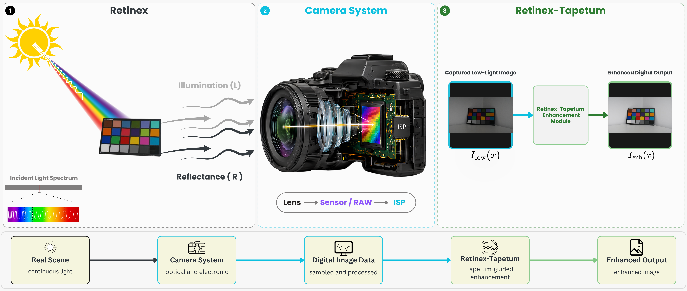
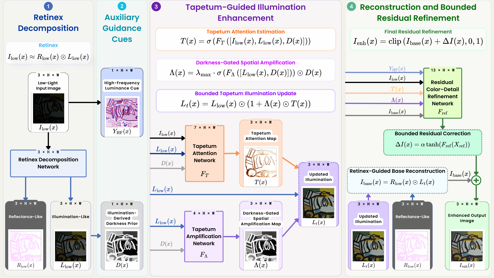

# Tapetum Framework

[English](README.md) · [Türkçe](README.tr.md) · [Deutsch](README.de.md) · [العربية](README.ar.md)

**ذكاء اصطناعي متمحور حول الإنسان · تمثيلات وسيطة قابلة للتفسير · بروتوكولات تجريبية قابلة للتدقيق**

> هذه نظرة بحثية عربية وليست ترجمة كاملة لملف README الإنجليزي. يرجع للأصل للتفاصيل المنهجية والرسوم والتجارب.

Retinex-Tapetum نموذج Retinex مدمج مستوحى من الأحياء وواعٍ بالظلام لتحسين صور RGB الملتقطة في الإضاءة المنخفضة. يحتاج التدريب المزدوج إلى صور مرجعية بالإضاءة العادية، لا الاستدلال. خرائط شبيهة بالانعكاس والإضاءة وأولوية الظلام والانتباه والتضخيم المبوّب بالظلام تتيح فحص النموذج، وليست تفسيرات سببية مثبتة أو منفعة بشرية متحققة.

## الطريقة والرسوم

<p align="center">
  
</p>

<p align="center">
  
</p>

<p align="center">
  
</p>

1. يقدر DecomNet `R_low` و`L_low` دون تفكيك فيزيائي وحيد.
2. يستخرج `D` من الإضاءة و`Y_HF` من المدخل.
3. يقدر `F_T` خريطة الانتباه `T` و`F_Λ` خريطة التضخيم `Λ` ثلاثيتي القنوات.
4. إعادة بناء Retinex مع تصحيح متبقٍ محدود في RGB.

```math
L_t(x) = L_{\mathrm{low}}(x) \odot \left[1 + \Lambda(x) \odot T(x)\right],
I_{\mathrm{base}}(x) = R_{\mathrm{low}}(x) \odot L_t(x).
```

```math
\Delta I(x) = 0.08 \tanh\left(F_{\mathrm{ref}}(X_{\mathrm{ref}})\right),
I_{\mathrm{enh}}(x) = \operatorname{clip}\left(I_{\mathrm{base}}(x) + \Delta I(x), 0, 1\right).
```

يتضمن `X_ref = [I_low, I_base, T, Λ, Y_HF]` 13 قناة. التضخيم بين 1 و1 + λ_max والتصحيح بين −0.08 و+0.08. يستخدم `Y_HF` في التصحيح النهائي فقط؛ T ليس انتباه Transformer. لا محاكاة فيزيائية للعين.

[Model](TAPETUM/RetinexTapetum/model.py) · [Figures](TAPETUM/paper_retinextapetum/figures/README.md) · [Diagnostics](TAPETUM/RetinexTapetum/RetinexTapetum_Ablation_Diagnostics_Dataset_Aware.py)

## نتائج التجارب

تبلغ المخطوطة عن 536,463 معاملاً و19.757 GMAC / 39.514 GFLOP عند 256 × 256؛ Tesla T4 FP32، دفعة 1، 50 إحماء و500 قياس: 33.73 ms و29.72 FPS. ليست إعادة تجربة مستقلة. أربعة نماذج خاصة بمجموعات البيانات حققت أعلى SSIM وأدنى LPIPS في الاختبارات الأربعة المزدوجة وأعلى PSNR في LOL-v2 Synthetic وUHD-LL down4. يتصدر RetinexFormer مقياس PSNR في LOL-v1 وLOL-v2 Real-Captured. إعداد KinD++ يعتمد على الإضاءة العادية.

| Paired benchmark | Selected seed | PSNR ↑ (dB) | SSIM ↑ | LPIPS ↓ |
|---|---:|---:|---:|---:|
| LOL-v1 (15 test pairs) | 42 | 21.0392 | **0.8316** | **0.1357** |
| LOL-v2 Real-Captured (100) | 123 | 20.0190 | **0.8405** | **0.1258** |
| LOL-v2 Synthetic (100) | 3407 | **25.0530** | **0.9322** | **0.0577** |
| UHD-LL down4 (150) | 3407 | **24.7107** | **0.9115** | **0.0884** |

## تقسيم البيانات والاختيار

| Dataset | Optimization pairs | Validation pairs | Independent test pairs |
|---|---:|---:|---:|
| LOL-v1 | 437 | 48 | 15 |
| LOL-v2 Real-Captured | 620 | 69 | 100 |
| LOL-v2 Synthetic | 810 | 90 | 100 |
| UHD-LL down4 | 1,884 | 116 | 150 |

الاختيار ببيانات التحقق فقط؛ أربع مراحل بحث معاملات: المحسّن والإضاءة والدقة والتفاصيل، 10/10/12/14 تجربة؛ البذور 42 و123 و3407. هامش PSNR 0.15 dB وSSIM 0.002 وLPIPS أخيراً. تستبعد الاختبارات من الاختيار.

[HPO](TAPETUM/HyperparameterSearch) · [Checkpoints](TAPETUM/RetinexTapetum/hyper_ckpt) · [Results](TAPETUM/paper_retinextapetum/comparison_results) · [Speed](TAPETUM/SpeedMetrics)

## الحدود

تدخلات الاستدلال على نقاط تحقق مدربة لا تعني اجتثاثاً بإعادة التدريب. التضخيم المبوّب بالظلام المسار الأساسي، والانتباه والتردد العالي أضعف أو غير متسقين. حذف التصحيح المتبقي يرفع PSNR في LOL-v2 Real-Captured من 20.02 إلى 22.69 dB. نتائج DICM وLIME وMEF وNPE وVV غير المرجعية متباينة؛ لا تفوق شامل. دراسات المستخدمين والتحقق السببي فرص بحثية مفتوحة.

## إعادة إنتاج التجارب

[](https://colab.research.google.com/github/human-centered-computing/tapetum-framework/blob/main/TAPETUM/RetinexTapetum_ALL_models.ipynb)

- **[Colab notebook source](./TAPETUM/RetinexTapetum_ALL_models.ipynb)**
- **[Full TAPETUM README: method, setup, datasets, HPO, evaluation, and checkpoints](./TAPETUM/README.md)**
- **[Annotated figure gallery](./TAPETUM/paper_retinextapetum/figures/README.md)**
- **[Implementation](./TAPETUM/RetinexTapetum)**
- **[Hyperparameter search records](./TAPETUM/HyperparameterSearch)**
- **[Inference speed logs](./TAPETUM/SpeedMetrics)**
- **[Shared TAPETUM Google Drive workspace](https://drive.google.com/drive/folders/13ayyEC3V1wWdX3AXdfL8y7VqnL8eTPFT?usp=sharing)**


يتوقع Colab ملفات `/content/drive/MyDrive/TAPETUM`. بعض البيانات والنماذج والنقاط والنتائج محفوظة في Drive؛ الاستنساخ أو جلسة Colab فارغة لا يضمن النتائج. استخدم الإعداد والنقطة المختارين لكل مجموعة لا قيم config.py الافتراضية.

## الاستشهاد والاتجاهات المقبلة

مخطوطة 2026 لمورات ديلن وسردار تشفتشي: Retinex-Tapetum: A Bio-Inspired Darkness-Aware Retinex Framework for Low-Light Image Enhancement. لا ادعاء قبول مجلة أو DOI أو مكان نشر. مخطط غير متحقق: فيديو ميداني/طائرات مسيرة مسجل، الاتساق الزمني والوميض، Tapetum Sentinel وتحليل صور الكوارث.

```bibtex
@misc{delen2026retinextapetum,
  title  = {Retinex-Tapetum: A Bio-Inspired Darkness-Aware Retinex Framework for Low-Light Image Enhancement},
  author = {Delen, Murat and Ciftci, Serdar},
  year   = {2026},
  note   = {Research manuscript and open-source framework},
  url    = {https://github.com/human-centered-computing/tapetum-framework}
}
```

## الترخيص

AGPL-3.0؛ [LICENSE](LICENSE). تقبل المساهمات بالترخيص نفسه.
