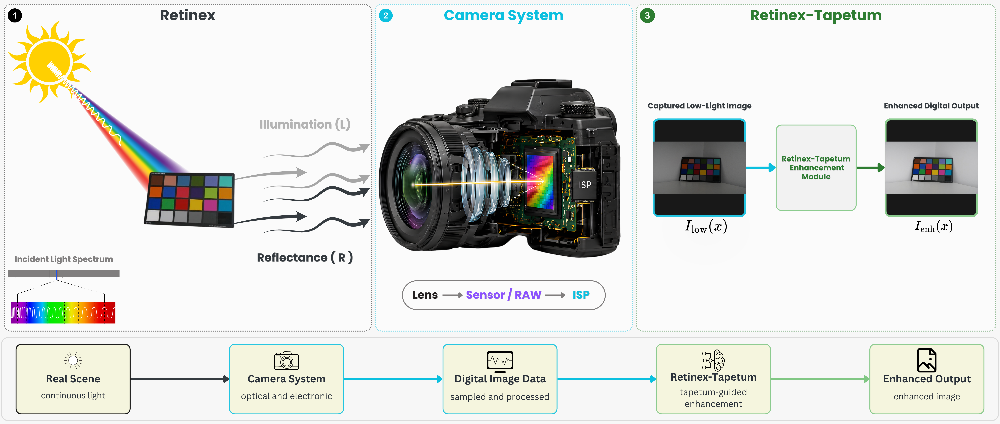
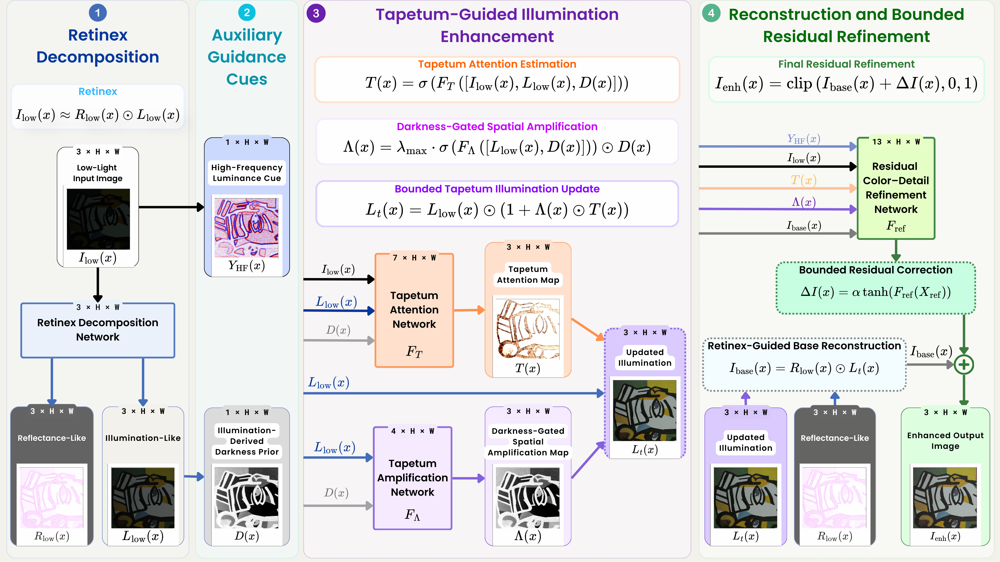

# Tapetum Framework

[English](README.md) · [Türkçe](README.tr.md) · [Deutsch](README.de.md) · [العربية](README.ar.md)

**Menschenzentrierte KI · interpretierbare Zwischenrepräsentationen · überprüfbare Versuchsprotokolle**

> Diese deutschsprachige Forschungsübersicht ist keine vollständige Übersetzung der englischen README. Für alle Methoden-, Abbildungs- und Versuchsdaten gilt das englische Original.

Retinex-Tapetum ist ein kompaktes, bioinspiriertes, dunkelheitsbewusstes Retinex-Modell zur Verbesserung bereits aufgenommener RGB-Bilder bei wenig Licht. Normallichtreferenzen sind für gepaartes Training, nicht für Inferenz nötig. Reflexions- und beleuchtungsähnliche Karten, Dunkelheitsprior, Aufmerksamkeits- und dunkelheitsgesteuerte Verstärkungskarten ermöglichen Modellinspektion, nicht nachgewiesene kausale Erklärungen oder bestätigten Nutzen für Menschen.

## Methode und Abbildungen

<p align="center">
  
</p>

<p align="center">
  
</p>

<p align="center">
  
</p>

1. DecomNet schätzt `R_low` und `L_low`, keine physikalisch eindeutige Zerlegung.
2. `D` aus der Beleuchtung und `Y_HF` aus dem Eingang.
3. `F_T` schätzt die dreikanalige Aufmerksamkeitskarte `T`, `F_Λ` die dreikanalige Verstärkungskarte `Λ`.
4. Retinex-basierte Rekonstruktion mit begrenzter RGB-Residualkorrektur.

```math
L_t(x) = L_{\mathrm{low}}(x) \odot \left[1 + \Lambda(x) \odot T(x)\right],
I_{\mathrm{base}}(x) = R_{\mathrm{low}}(x) \odot L_t(x).
```

```math
\Delta I(x) = 0.08 \tanh\left(F_{\mathrm{ref}}(X_{\mathrm{ref}})\right),
I_{\mathrm{enh}}(x) = \operatorname{clip}\left(I_{\mathrm{base}}(x) + \Delta I(x), 0, 1\right).
```

`X_ref = [I_low, I_base, T, Λ, Y_HF]` enthält 13 Kanäle. Verstärkung liegt zwischen 1 und 1 + λ_max, Residuum zwischen −0,08 und +0,08. `Y_HF` nur in der Endkorrektur; T ist keine Transformer-Aufmerksamkeit. Keine physikalische Augensimulation.

[Model](TAPETUM/RetinexTapetum/model.py) · [Figures](TAPETUM/paper_retinextapetum/figures/README.md) · [Diagnostics](TAPETUM/RetinexTapetum/RetinexTapetum_Ablation_Diagnostics_Dataset_Aware.py)

## Versuchsergebnisse

Manuskript: 536.463 Parameter; 19,757 GMAC / 39,514 GFLOP bei 256 × 256; Tesla T4 FP32, Batch 1, 50 Warm-up und 500 Messungen: 33,73 ms, 29,72 FPS. Keine unabhängige Wiederholung. Vier datensatzspezifische Modelle berichten höchsten SSIM und niedrigsten LPIPS in allen vier gepaarten Tests sowie höchsten PSNR auf LOL-v2 Synthetic und UHD-LL down4. RetinexFormer führt PSNR auf LOL-v1 und LOL-v2 Real-Captured. KinD++ nutzt eine normallichtabhängige Einstellung.

| Paired benchmark | Selected seed | PSNR ↑ (dB) | SSIM ↑ | LPIPS ↓ |
|---|---:|---:|---:|---:|
| LOL-v1 (15 test pairs) | 42 | 21.0392 | **0.8316** | **0.1357** |
| LOL-v2 Real-Captured (100) | 123 | 20.0190 | **0.8405** | **0.1258** |
| LOL-v2 Synthetic (100) | 3407 | **25.0530** | **0.9322** | **0.0577** |
| UHD-LL down4 (150) | 3407 | **24.7107** | **0.9115** | **0.0884** |

## Datenteilung und Auswahl

| Dataset | Optimization pairs | Validation pairs | Independent test pairs |
|---|---:|---:|---:|
| LOL-v1 | 437 | 48 | 15 |
| LOL-v2 Real-Captured | 620 | 69 | 100 |
| LOL-v2 Synthetic | 810 | 90 | 100 |
| UHD-LL down4 | 1,884 | 116 | 150 |

Auswahl ausschließlich mit Validierungsdaten; vier HPO-Stufen Optimierer, Beleuchtung, Wiedergabetreue, Details mit 10/10/12/14 Versuchen; Seeds 42, 123, 3407. PSNR-Toleranz 0,15 dB und SSIM 0,002; LPIPS zuletzt. Tests bleiben unberührt.

[HPO](TAPETUM/HyperparameterSearch) · [Checkpoints](TAPETUM/RetinexTapetum/hyper_ckpt) · [Results](TAPETUM/paper_retinextapetum/comparison_results) · [Speed](TAPETUM/SpeedMetrics)

## Grenzen

Inferenzinterventionen auf trainierten Checkpoints sind keine neu trainierten Ablationen. Dunkelheitsgesteuerte Verstärkung ist zentral; Aufmerksamkeit und Hochfrequenzsignal wirken schwächer bzw. inkonsistent. Ohne Residualverfeinerung steigt LOL-v2 Real-Captured PSNR von 20,02 auf 22,69 dB. Referenzfreie DICM-, LIME-, MEF-, NPE-, VV-Ergebnisse sind gemischt, keine universelle Überlegenheit. Nutzungsstudien und kausale Erklärungsvalidierung bleiben offen.

## Experimente reproduzieren

[](https://colab.research.google.com/github/human-centered-computing/tapetum-framework/blob/main/TAPETUM/RetinexTapetum_ALL_models.ipynb)

- **[Colab notebook source](./TAPETUM/RetinexTapetum_ALL_models.ipynb)**
- **[Full TAPETUM README: method, setup, datasets, HPO, evaluation, and checkpoints](./TAPETUM/README.md)**
- **[Annotated figure gallery](./TAPETUM/paper_retinextapetum/figures/README.md)**
- **[Implementation](./TAPETUM/RetinexTapetum)**
- **[Hyperparameter search records](./TAPETUM/HyperparameterSearch)**
- **[Inference speed logs](./TAPETUM/SpeedMetrics)**
- **[Shared TAPETUM Google Drive workspace](https://drive.google.com/drive/folders/13ayyEC3V1wWdX3AXdfL8y7VqnL8eTPFT?usp=sharing)**


Colab erwartet `/content/drive/MyDrive/TAPETUM`. Manche Datensätze, Baselines, Checkpoints und Ergebnisse liegen in Drive; ein Clone oder leeres Colab garantiert keine Reproduktion. Datensatzspezifische Auswahlkonfiguration und Checkpoint statt config.py-Defaults verwenden.

## Zitation und Ausblick

Forschungsmanuskript 2026 von Murat Delen und Serdar Ciftci: Retinex-Tapetum: A Bio-Inspired Darkness-Aware Retinex Framework for Low-Light Image Enhancement. Keine Zeitschriftenannahme, DOI oder Publikationsort behauptet. Geplant, nicht validiert: aufgezeichnetes Drohnen-/Feldvideo, zeitliche Konsistenz und Flimmern, Tapetum Sentinel und Katastrophenbildanalyse.

```bibtex
@misc{delen2026retinextapetum,
  title  = {Retinex-Tapetum: A Bio-Inspired Darkness-Aware Retinex Framework for Low-Light Image Enhancement},
  author = {Delen, Murat and Ciftci, Serdar},
  year   = {2026},
  note   = {Research manuscript and open-source framework},
  url    = {https://github.com/human-centered-computing/tapetum-framework}
}
```

## Lizenz

AGPL-3.0; [LICENSE](LICENSE). Beiträge unter derselben Lizenz.
