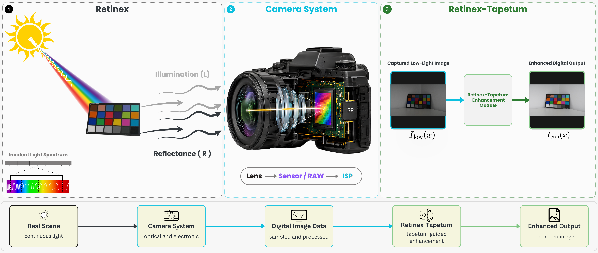
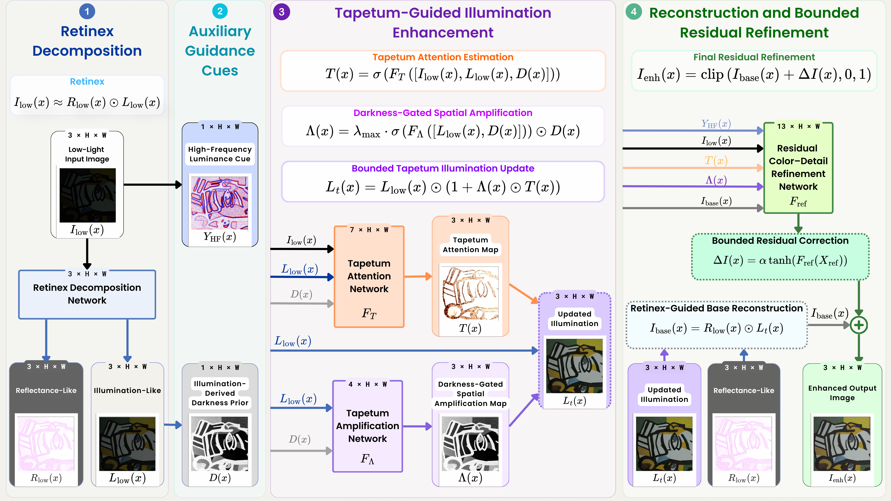

# Tapetum Framework

> Çeviri durumu: Yapay zekâ destekli taslak; insan dil incelemesi bekliyor.

[English](README.md) · [Türkçe](README.tr.md) · [Deutsch](README.de.md) · [العربية](README.ar.md)

**İnsan merkezli yapay zekâ · yorumlanabilir ara temsiller · denetlenebilir deney protokolleri**

> Bu Türkçe araştırma özeti, İngilizce ana README'nin tam çevirisi değildir. Yöntem, görseller ve deneysel ayrıntılar için kaynak belgeye bakın.

Retinex-Tapetum; kaydedilmiş RGB görüntülerde düşük ışık iyileştirmesi için karanlık farkındalıklı, biyolojiden esinlenen kompakt Retinex modelidir. Eğitim için eşlenmiş normal ışık referansı gerekir; çıkarımda gerekmez. Ara temsiller (yansıtım ve aydınlatma benzeri haritalar, karanlık öncülü, dikkat ve karanlıkla kapılanan güçlendirme) modelin incelenmesini sağlar; doğrulanmış nedensel açıklama veya kullanıcı faydası kanıtı değildir.

## Yöntem ve görsel anlatım

<p align="center">
  
</p>

<p align="center">
  
</p>

<p align="center">
  
</p>

1. DecomNet, `R_low` ve `L_low` tahmin eder; fiziksel olarak benzersiz ayrıştırma değildir.
2. `D` aydınlatmadan, `Y_HF` girişten türetilir.
3. `F_T` üç kanallı `T` dikkat haritasını, `F_Λ` üç kanallı `Λ` güçlendirme haritasını tahmin eder.
4. Retinex tabanlı yeniden oluşturma, sınırlandırılmış RGB artık düzeltmesiyle tamamlanır.

```math
L_t(x) = L_{\mathrm{low}}(x) \odot \left[1 + \Lambda(x) \odot T(x)\right],
I_{\mathrm{base}}(x) = R_{\mathrm{low}}(x) \odot L_t(x).
```

```math
\Delta I(x) = 0.08 \tanh\left(F_{\mathrm{ref}}(X_{\mathrm{ref}})\right),
I_{\mathrm{enh}}(x) = \operatorname{clip}\left(I_{\mathrm{base}}(x) + \Delta I(x), 0, 1\right).
```

`X_ref = [I_low, I_base, T, Λ, Y_HF]` 13 kanaldır. Güçlendirme 1 ile 1 + λ_max, artık düzeltme −0.08 ile +0.08 arasındadır. `Y_HF` sadece son düzeltmede kullanılır; T, Transformer dikkati değildir. Fiziksel göz simülasyonu yapılmaz.

[Model](TAPETUM/RetinexTapetum/model.py) · [Figures](TAPETUM/paper_retinextapetum/figures/README.md) · [Diagnostics](TAPETUM/RetinexTapetum/RetinexTapetum_Ablation_Diagnostics_Dataset_Aware.py)

## Deney sonuçları

Makalenin raporladığı 536.463 parametre, 256 × 256 için 19.757 GMAC / 39.514 GFLOP; Tesla T4 FP32, batch 1, 50 ısınma ve 500 ölçüm: 33,73 ms, 29,72 FPS. Bunlar bağımsız tekrar çalıştırma değildir. Dört ayrı veri kümesine özgü model tüm eşlenmiş testlerde en yüksek SSIM ve en düşük LPIPS, sentetik LOL-v2 ve UHD-LL down4'te en yüksek PSNR bildirmiştir. LOL-v1 ve LOL-v2 Real-Captured PSNR lideri RetinexFormer'dır. KinD++ karşılaştırmasında normal ışığa bağlı ayarlama vardır.

| Paired benchmark | Selected seed | PSNR ↑ (dB) | SSIM ↑ | LPIPS ↓ |
|---|---:|---:|---:|---:|
| LOL-v1 (15 test pairs) | 42 | 21.0392 | **0.8316** | **0.1357** |
| LOL-v2 Real-Captured (100) | 123 | 20.0190 | **0.8405** | **0.1258** |
| LOL-v2 Synthetic (100) | 3407 | **25.0530** | **0.9322** | **0.0577** |
| UHD-LL down4 (150) | 3407 | **24.7107** | **0.9115** | **0.0884** |

## Veri ayrımı ve seçim

| Dataset | Optimization pairs | Validation pairs | Independent test pairs |
|---|---:|---:|---:|
| LOL-v1 | 437 | 48 | 15 |
| LOL-v2 Real-Captured | 620 | 69 | 100 |
| LOL-v2 Synthetic | 810 | 90 | 100 |
| UHD-LL down4 | 1,884 | 116 | 150 |

Seçim yalnız doğrulama verisiyle yapılır; optimizasyon, aydınlatma, sadakat, ayrıntı aşamaları 10/10/12/14 deneme; üç tohum 42, 123, 3407. PSNR toleransı 0,15 dB, SSIM 0,002; son ölçüt LPIPS. Test verisi seçim dışında tutulur.

[HPO](TAPETUM/HyperparameterSearch) · [Checkpoints](TAPETUM/RetinexTapetum/hyper_ckpt) · [Results](TAPETUM/paper_retinextapetum/comparison_results) · [Speed](TAPETUM/SpeedMetrics)

## Sınırlar

Sabit eğitilmiş modellerde çıkarım müdahaleleri yeniden eğitimli ablation değildir. Karanlıkla kapılanan güçlendirme ana işlevsel yol; dikkat ve yüksek frekans ipucu etkisi daha küçük veya tutarsız. Artık düzeltmeyi kaldırmak LOL-v2 Real-Captured PSNR'yi 20,02'den 22,69 dB'ye çıkarır. Referanssız DICM, LIME, MEF, NPE, VV sonuçları karışıktır; evrensel üstünlük iddiası yoktur. İnsan kullanıcı araştırması ve nedensel açıklama doğrulaması açık konulardır.

## Deneyleri yeniden üretme

[](https://colab.research.google.com/github/human-centered-computing/tapetum-framework/blob/main/TAPETUM/RetinexTapetum_ALL_models.ipynb)

- **[Colab notebook source](./TAPETUM/RetinexTapetum_ALL_models.ipynb)**
- **[Full TAPETUM README: method, setup, datasets, HPO, evaluation, and checkpoints](./TAPETUM/README.md)**
- **[Annotated figure gallery](./TAPETUM/paper_retinextapetum/figures/README.md)**
- **[Implementation](./TAPETUM/RetinexTapetum)**
- **[Hyperparameter search records](./TAPETUM/HyperparameterSearch)**
- **[Inference speed logs](./TAPETUM/SpeedMetrics)**
- **[Shared TAPETUM Google Drive workspace](https://drive.google.com/drive/folders/13ayyEC3V1wWdX3AXdfL8y7VqnL8eTPFT?usp=sharing)**


Colab iş akışı `/content/drive/MyDrive/TAPETUM` dosyalarını bekler. Veri kümeleri, modeller ve deney çıktılarının bir bölümü Drive'dadır; boş Colab veya yalnız klon aynı sonuçları garanti etmez. config.py varsayılanları yerine seçilmiş veri kümesi yapılandırması ve checkpoint kullanılmalıdır.

## Atıf ve gelecek

Murat Delen ve Serdar Ciftci'nin 2026 araştırma makalesi: Retinex-Tapetum: A Bio-Inspired Darkness-Aware Retinex Framework for Low-Light Image Enhancement. Dergi kabulü, DOI veya yayın yeri iddiası yoktur. Gelecek araştırma: kaydedilmiş drone/saha videosu, zamansal tutarlılık, titreşim, Tapetum Sentinel ve afet görüntüsü analizi; henüz doğrulanmadı.

```bibtex
@misc{delen2026retinextapetum,
  title  = {Retinex-Tapetum: A Bio-Inspired Darkness-Aware Retinex Framework for Low-Light Image Enhancement},
  author = {Delen, Murat and Ciftci, Serdar},
  year   = {2026},
  note   = {Research manuscript and open-source framework},
  url    = {https://github.com/human-centered-computing/tapetum-framework}
}
```

## Lisans

AGPL-3.0; [LICENSE](LICENSE). Katkılar aynı lisansla kabul edilir.
