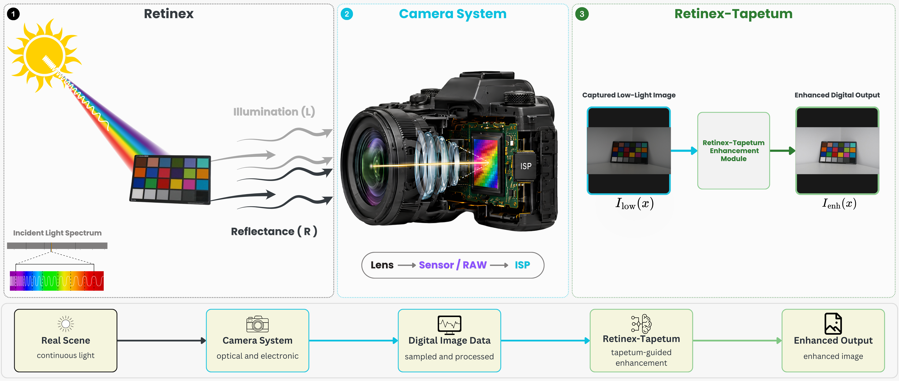
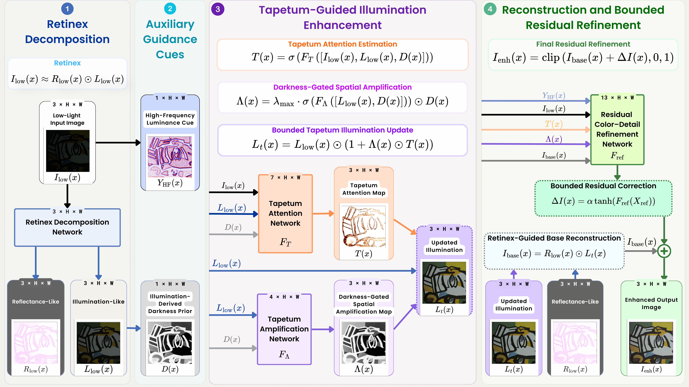

# TAPETUM

**A reproducible low-light image enhancement research workspace centered on Retinex-Tapetum and standardized multi-model evaluation.**

[](https://www.python.org/)
[](https://pytorch.org/)
[](https://colab.research.google.com/github/human-centered-computing/tapetum-framework/blob/main/TAPETUM/RetinexTapetum_ALL_models.ipynb)
[](LICENSE)

TAPETUM is an experimental framework for low-light image enhancement (LLIE). It brings together the proposed **Retinex-Tapetum** model, baseline implementations, dataset management, hyperparameter search, checkpoint selection, quantitative and visual evaluation, speed profiling, and paper artifacts under one reproducible workspace.

The repository intentionally uses a **hybrid GitHub + Google Drive layout**:

- **GitHub** stores source code, experiment logic, compact reproducibility artifacts, selected checkpoint metadata, paper figures, and comparison outputs.
- **Google Drive** stores the complete TAPETUM workspace, including large datasets, baseline repositories, checkpoints, generated images, and experiment outputs that are not practical to keep entirely in Git.
- The all-model Colab workflow contains dataset-management logic that can reconstruct supported missing datasets from configured sources when available.
- The `YEDEK` directory in Google Drive is intentionally excluded from the documented repository structure.

## Resources

- **TAPETUM repository:** https://github.com/human-centered-computing/tapetum-framework/tree/main/TAPETUM
- **Complete TAPETUM Google Drive archive:** https://drive.google.com/drive/folders/13ayyEC3V1wWdX3AXdfL8y7VqnL8eTPFT?usp=sharing
- **Retinex-Tapetum paper artifacts:** [paper_retinextapetum](./paper_retinextapetum)
- **Run the all-model workflow in Google Colab:** [RetinexTapetum_ALL_models.ipynb](./RetinexTapetum_ALL_models.ipynb)

## Human-Centered and Inspectable AI Perspective

**Research objective:** Advance **Human-Centered AI** through the development of **interpretable intermediate representations and auditable experimental protocols** for low-light image enhancement.

This research direction examines how explicit model stages and accessible intermediate signals can make enhancement behavior easier to inspect and question, while documented data partitions, HPO trials, multi-seed confirmation, representative-checkpoint selection, test metrics, and runtime profiling enable reproducible, critically auditable evaluation.

**Türkçe tanım:** İnsan merkezli yapay zekâ hedefi doğrultusunda yorumlanabilir ara temsiller ve denetlenebilir deney protokolleri geliştirmeye yönelik bir araştırma.

The intended human-facing value is greater inspectability and experimental transparency for researchers and practitioners. These are **research aims and available workflow properties**; the reported experiments do **not** constitute a formal human-subject study, validated causal explanation benchmark, or certified trustworthy-AI evaluation.

The model makes several signals available for examination: the reflectance-like representation `R_low`, illumination-like representation `L_low`, illumination-derived darkness prior `D`, learned Tapetum Attention Map `T`, Darkness-Gated Spatial Amplification Map `Lambda`, high-frequency luminance cue `Y_HF`, and bounded residual correction `Delta I`. Taken together, these support **mechanism-oriented inspection** of the enhancement pipeline. Attention values and learned feature maps should not be equated with independently validated causal explanations.

### Auditing the research workflow

The **interpretable intermediate representations and auditable experimental protocols** objective can be examined through a traceable set of artifacts:

1. **Model stages and intermediate signals:** [`RetinexTapetum/model.py`](./RetinexTapetum/model.py) and the [architecture figure](./paper_retinextapetum/figures/tapetum_architecture_diagram.png). These learned representations facilitate mechanism-oriented inspection, but they are not validated causal feature attributions.
2. **Data partitioning:** [LOL-v1](./HyperparameterSearch/lol_v1/split_manifest.json), [LOL-v2 Real-Captured](./HyperparameterSearch/lol_v2_real/split_manifest.json), [LOL-v2 Synthetic](./HyperparameterSearch/lol_v2_synthetic/split_manifest.json), and [UHD-LL down4](./HyperparameterSearch/uhd_ll_down4/split_manifest.json) split manifests.
3. **Hyperparameter and checkpoint selection:** [HPO records](./HyperparameterSearch) contain the staged search and three-seed confirmation summaries. Paired test results represent four separately selected dataset-specific checkpoints.
4. **Functional diagnostics:** [Fixed-checkpoint intervention code](./RetinexTapetum/RetinexTapetum_Ablation_Diagnostics_Dataset_Aware.py) supports diagnostic forward-path comparisons; it does not constitute retrained architecture ablation.
5. **Evaluation and reproducibility:** [Comparison outputs](./paper_retinextapetum/comparison_results), [speed records](./SpeedMetrics), and the [Colab notebook](./RetinexTapetum_ALL_models.ipynb) allow independent examination and supported re-execution when the required Drive assets and runtime dependencies are available.

This documentation supports **transparent scrutiny and experimental auditability**; it does not claim validated explanation faithfulness or completed human-subject studies.

### Visual research artifacts — perception, acquisition, and biological inspiration

The figures serve different explanatory purposes. They should not all be described as generic “before/after enhancement” comparisons.

| Figure | Interpretation |
|---|---|
| [Retinex perception → camera pipeline → RGB observation](./paper_retinextapetum/figures/from_real_to_enhancement_retinex_tapetum.png) | **Left:** Retinex and human scene/color perception through illumination, reflectance, and visual context. **Middle:** camera image formation and image-signal processing. **Right:** the recorded RGB image shaped by physical scene information, camera processing, and possible noise/artifacts. |
| [Retinex and biological tapetum lucidum](./paper_retinextapetum/figures/tapedum_lucidum.png) | Relates Retinex's illumination/reflectance understanding of vision to biological low-light light-return in animals; this is the motivation for an *abstract learned* enhancement operator, **not** a biological optics simulation. |
| [Four-stage Retinex-Tapetum architecture](./paper_retinextapetum/figures/tapetum_architecture_diagram.png) | Shows how Retinex decomposition and auxiliary guidance lead to darkness-aware illumination modulation and bounded output refinement. |

**Retinex perception and camera imaging**



The first schematic is read **left → center → right**: (i) how illumination and surface reflectance contribute to perceived scene appearance under Retinex-inspired thinking, (ii) how camera acquisition and processing transform incoming scene information, and (iii) how the saved RGB image contains both scene-derived information and acquisition-dependent effects such as noise. A recorded RGB image is not a direct physical scene measurement, and a Retinex-like decomposition is not uniquely recoverable from a single RGB image without modeling assumptions.

**Retinex and biological tapetum lucidum**


The companion figure links the **Retinex model of visual perception** with a distinct **biological low-light adaptation**: the *tapetum lucidum* reflects some incoming light back toward retinal photoreceptors in many animals. Retinex-Tapetum abstracts this functional motivation through a learned tapetum response and darkness-gated illumination amplification in the image domain. It does not physically return photons or reconstruct an animal's visual system.

**Model realization**



For original image files, more detailed left/middle/right readings and interpretive limits, see the **[annotated research figure gallery](./paper_retinextapetum/figures/README.md)**.

**Türkçe açıklama:** İlk görsel Retinex'in sahne algısı yaklaşımı, kameradaki görüntü işleme zinciri ve gürültü/işleme etkilerini taşıyan RGB görüntü arasındaki ilişkiyi; ikinci görsel ise Retinex yaklaşımı ile biyolojik *tapetum lucidum* ışık geri yansıtma işlevi arasındaki esinlenme ilişkisini göstermektedir.

**Interpretation boundary.** The reported PSNR/SSIM/LPIPS results measure image fidelity and perceptual similarity under defined protocols; they do not measure end-user satisfaction, task performance, or explanation faithfulness. Fixed-checkpoint branch interventions provide diagnostics but do not establish retrained component indispensability.

## Retinex-Tapetum

**Retinex-Tapetum: A Bio-Inspired Darkness-Aware Retinex Framework for Low-Light Image Enhancement** is a compact Retinex-based LLIE model inspired by the functional light-reuse principle of the *tapetum lucidum*.

The framework does **not** attempt to simulate eye anatomy or physical optical light transport. Instead, it translates the biological motivation into an explicit, learnable, darkness-aware image-domain enhancement mechanism.

Given a low-light RGB image, the model:

1. estimates reflectance-like and illumination-like representations,
2. derives an illumination darkness prior,
3. predicts a learned three-channel tapetum response `T`,
4. predicts a darkness-gated three-channel spatial amplification map `Lambda`,
5. updates illumination using a bounded multiplicative rule,
6. recombines the Retinex components, and
7. applies bounded residual color/detail refinement.

The principal illumination update is

```text
L_t = L_low * (1 + Lambda * T)
```

where the amplification magnitude is explicitly bounded and reduced in relatively bright regions by darkness gating.

<p align="center">
  
</p>

### Model characteristics

- **Trainable parameters:** 536,463 (~0.5365 M)
- **Reported complexity:** 19.757 GMACs
- **Reported mean latency:** 33.47 ms (mean of four selected checkpoint profiling runs)
- **Reported mean throughput:** 29.88 FPS (mean of four reported FPS measurements)
- **Mean checkpoint file size:** 6.613 MB across the four profiled checkpoints
- **Runtime protocol:** FP32, batch size 1, `256 x 256`, NVIDIA Tesla T4
- **Training crop:** `256 x 256`
- **Optimizer:** Adam
- **Maximum training horizon:** 120 epochs
- **Final confirmation seeds:** `42`, `123`, `3407`

## Reported Retinex-Tapetum Results

The selected dataset-specific checkpoints reported in the current manuscript obtain the following independent test-set results:

| Dataset | Selected seed | PSNR ↑ | SSIM ↑ | LPIPS ↓ |
|---|---:|---:|---:|---:|
| LOL-v1 | 42 | 21.0392 | 0.8316 | 0.1357 |
| LOL-v2 Real-Captured | 123 | 20.0190 | 0.8405 | 0.1258 |
| LOL-v2 Synthetic | 3407 | 25.0530 | 0.9322 | 0.0577 |
| UHD-LL down4 | 3407 | 24.7107 | 0.9115 | 0.0884 |

Across these four paired benchmarks, the manuscript reports that Retinex-Tapetum achieves the best SSIM and LPIPS in all four cases, while obtaining the best PSNR on LOL-v2 Synthetic and UHD-LL down4.

## Compared Methods

The TAPETUM workspace contains or references the following comparison methods:

- RetinexNet
- KinD++ (`KinD_plus` in the Drive workspace)
- URetinex-Net++ (`URetinex-Net-PLUS` in the Drive workspace)
- RetinexFormer
- RUAS
- Zero-DCE
- LIME

The common evaluation pipeline recomputes metrics from generated output images rather than mixing values copied from different publications or incompatible evaluation settings. **Protocol qualification:** The paired KinD++ results use reference-guided illumination-ratio inference and are not strictly blind-inference equivalents of the other methods. In the paired URetinex-Net++ evaluations, the illumination ratio is calibrated using training-set information without test-time normal-light ground truth.

## Repository / Drive Structure

The structure below follows the **Google Drive TAPETUM filesystem**, except for `YEDEK`. Some directories are currently Drive-backed and therefore may not appear in a fresh GitHub clone. They can be copied from the shared Drive archive or regenerated by the relevant Colab workflow.

```text
TAPETUM/
├── README.md
├── LICENSE
│
├── RetinexTapetum/                         # Main RetinexTapetum implementation [GitHub + Drive]
│   ├── model.py
│   ├── config.py
│   ├── dataset.py
│   ├── losses.py
│   ├── train.py
│   ├── test.py
│   ├── evaluate_metrics.py
│   ├── RetinexTapetum_Ablation_Diagnostics_Dataset_Aware.py
│   └── hyper_ckpt/
│       ├── lol_v1/
│       ├── lol_v2_real/
│       ├── lol_v2_synthetic/
│       └── uhd_ll_down4/
│
├── HyperparameterSearch/                   # HPO stages, confirmation runs and summaries [GitHub + Drive]
│   ├── lol_v1/
│   ├── lol_v2_real/
│   ├── lol_v2_synthetic/
│   ├── uhd_ll_down4/
│   ├── RetinexTapetum_Implementation_Details.tex
│   ├── RetinexTapetum_LaTeX_Tables.tex
│   └── RetinexTapetum_LaTeX_Preview.pdf
│
├── paper_retinextapetum/                   # Paper figures and comparison artifacts [GitHub + Drive]
│   ├── figures/
│   └── comparison_results/
│       ├── all_models/
│       └── multi_dataset/
│
├── RetinexNet/                             # Baseline implementation [Drive]
├── KinD_plus/                              # KinD++ baseline [Drive]
├── URetinex-Net-PLUS/                      # URetinex-Net++ baseline [Drive]
├── RetinexFormer/                          # Baseline implementation [Drive]
├── RUAS/                                   # Baseline implementation [Drive]
├── Zero-DCE/                               # Baseline implementation [Drive]
├── LIME/                                   # Classical baseline [Drive]
│
├── SpeedMetrics/                           # Standardized runtime profiling [Drive]
│   ├── TAPETUM_Speed_Profiler_Colab.ipynb
│   ├── TAPETUM_Speed_Profiler_Colab.py
│   ├── LOL-v1/
│   ├── LOL-v2 Real-Captured/
│   ├── LOL-v2 Synthetic/
│   └── UHD-LL down4/
│
├── datasets/                               # Large datasets are Drive-backed
│   ├── LOL-v1/
│   ├── LOL-v2/
│   ├── UHD-LL down4/
│   ├── SICE/
│   ├── LoLI-Street/
│   ├── DICM/
│   ├── LIME/
│   ├── MEF/
│   ├── NPE/
│   ├── VV/
│   ├── info.csv
│   └── dataset_info.txt
│
├── RESULT/                                 # Canonical dataset/model outputs [Drive]
│   ├── LOL-v1/
│   ├── LOL-v2/
│   └── UHD-LL down4/
│
├── RESULTS/                                # Check/comparison result archives [Drive]
│   ├── LOL_v1(check)/
│   ├── LOL_v2_Real_captured(check)/
│   ├── LOL_v2_Synthetic(check)/
│   ├── UHD_LL_down4(check)/
│   └── LIME_default(check)/
│
├── RetinexTapetum_ALL_models.ipynb         # Main Colab-oriented all-model workflow [GitHub + Drive]
├── retinextapetum_all_models.py            # Python export of the all-model workflow [GitHub + Drive]
└── RetinexTapetum_v1 ALL models.ipynb      # Earlier Drive snapshot / legacy workflow [Drive]
```

### Excluded directory

`YEDEK/` is a backup workspace and is deliberately **not** part of the repository structure documented above.

## Dataset Organization

Paired datasets follow the standard structure expected by the Retinex-Tapetum training and test code:

```text
datasets/<DATASET>/
├── Train/
│   ├── Low/
│   └── Normal/
└── Test/
    ├── Low/
    └── Normal/
```

For LOL-v2, the variant level is inserted before `Train` and `Test`:

```text
datasets/LOL-v2/
├── Real_captured/
│   ├── Train/{Low,Normal}/
│   └── Test/{Low,Normal}/
└── Synthetic/
    ├── Train/{Low,Normal}/
    └── Test/{Low,Normal}/
```

Reference-free datasets such as DICM, LIME, MEF, NPE, and VV are used for cross-domain no-reference evaluation and do not require paired normal-light references.

## Checkpoints and Hyperparameter Search

Hyperparameter optimization is performed independently for the four paired training domains:

- LOL-v1
- LOL-v2 Real-Captured
- LOL-v2 Synthetic
- UHD-LL down4

The final configuration-selection protocol uses validation data only. The four Optuna-TPE HPO stages (optimizer, illumination, fidelity, and detail) target 10, 10, 12, and 14 completed trials, using search/split seed `42`. The original dataset-specific `config.py` profile is retained as the **source-profile baseline**. From the completed final-stage trials, candidates are ranked repeatedly by the PSNR-tolerance / SSIM-tolerance / minimum-LPIPS rule; duplicated hyperparameter settings (including the baseline) are removed, and the top two distinct HPO settings enter confirmation alongside the baseline. The three independent confirmation seeds are `42`, `123`, and `3407`. The selected representative checkpoint is chosen using validation metrics only; official test partitions are excluded from configuration, seed, and checkpoint selection.

| Paired benchmark | Optimization pairs | Validation pairs | Independent test pairs |
|---|---:|---:|---:|
| LOL-v1 | 437 | 48 | 15 |
| LOL-v2 Real-Captured | 620 | 69 | 100 |
| LOL-v2 Synthetic | 810 | 90 | 100 |
| UHD-LL down4 | 1,884 | 116 | 150 |

UHD-LL down4 uses filename-based numeric ID blocks of size 25 to prevent closely related image IDs from crossing the optimization/validation boundary. This grouping results in 116 validation pairs. Dataset split manifests and HPO summaries are stored under [HyperparameterSearch](./HyperparameterSearch).

Selected checkpoint material is organized under:

```text
RetinexTapetum/hyper_ckpt/<dataset>/
├── best_hyperparameters.json
├── candidate_summary.csv
├── seed_results.csv
└── checkpoints/
    ├── CHECKPOINT_SELECTION.md
    ├── seed_42/
    ├── seed_123/
    ├── seed_3407/
    └── selected/
```

The `selected/` directory is the canonical representative checkpoint location for each dataset-specific model.

## Output Organization

In the Colab/Drive workflow, Retinex-Tapetum uses the common result tree:

```text
/content/drive/MyDrive/TAPETUM/RESULT/
└── <dataset>/
    └── [<variant>/]
        └── RetinexTapetum/
            ├── checkpoints/
            ├── results/
            │   └── Test/
            ├── paper_metrics/
            ├── analysis/
            └── colab_run_summary.json
```

This keeps training, resume, inference, metric generation, and paper-oriented analysis under a single dataset-specific location.

## Quick Start

### Option 1 — Google Colab (recommended)

Open the all-model notebook:

[](https://colab.research.google.com/github/human-centered-computing/tapetum-framework/blob/main/TAPETUM/RetinexTapetum_ALL_models.ipynb)

The Colab workflow is designed around:

```text
/content/drive/MyDrive/TAPETUM
```

This notebook is the **Google Colab workflow used to generate the manuscript experiments**. It mounts Google Drive, supports dataset/workspace management, and includes multi-model training and evaluation logic.

To rerun supported experiments:

1. Open the notebook above in Google Colab; choose a GPU runtime for model training and GPU profiling.
2. Follow its setup cells and authorize the Google Drive mount.
3. Make the complete TAPETUM workspace available at `/content/drive/MyDrive/TAPETUM`. Large datasets, some baseline repositories, checkpoints and other artifacts may need to be copied/restored from the [shared Drive archive](https://drive.google.com/drive/folders/13ayyEC3V1wWdX3AXdfL8y7VqnL8eTPFT?usp=sharing). **Viewing the shared folder does not automatically mount it at the expected `MyDrive` path**; keep the directory structure intact, with access and dataset-license requirements respected.
4. In the notebook, select the intended model, dataset and operation, then execute the appropriate setup, training/HPO, inference and metric cells. A complete fresh HPO + three-seed training rerun is computationally expensive.
5. For reproduction of the reported evaluation numbers without retraining, use the selected dataset-specific checkpoints and official test subsets; use the fixed split manifests and recorded hyperparameters when repeating the training protocol.

**Reproducibility scope:** The executable notebook and related source code are public, but not all large assets are stored in GitHub. An empty Colab session is not guaranteed to regenerate all reported results without the required datasets, checkpoints, software dependencies and computational resources. Exact numbers can also vary with software versions and nondeterministic GPU operations. This README update is a documentation change, not a fresh full rerun of the notebook.

### Option 2 — Retinex-Tapetum training/testing from Python

Clone the repository and enter the model directory:

```bash
git clone https://github.com/human-centered-computing/tapetum-framework.git
cd tapetum-framework/TAPETUM/RetinexTapetum
```

For a local run, point results to the local TAPETUM workspace:

```bash
export RETINEX_RESULT_ROOT="$(cd .. && pwd)/RESULT"
```

Example — LOL-v1:

```bash
RETINEX_DATA_NAME=LOL-v1 \
RETINEX_DATA_VARIANT=None \
python train.py

RETINEX_DATA_NAME=LOL-v1 \
RETINEX_DATA_VARIANT=None \
python test.py
```

Example — LOL-v2 Real-Captured:

```bash
RETINEX_DATA_NAME=LOL-v2 \
RETINEX_DATA_VARIANT=Real_captured \
python train.py

RETINEX_DATA_NAME=LOL-v2 \
RETINEX_DATA_VARIANT=Real_captured \
python test.py
```

Before running locally, ensure the required dataset and checkpoint directories exist under the expected TAPETUM structure. For large assets, restore them from the shared Drive archive.

## Evaluation

The framework uses the following full-reference metrics on paired benchmarks:

- **PSNR** — higher is better
- **SSIM** — higher is better
- **LPIPS** — lower is better

The paper-oriented evaluation additionally uses no-reference criteria including NIQE, BRISQUE, PIQE, MUSIQ, MANIQA, CLIPIQA, and LOE.

Speed profiling uses FP32, batch size 1, `256 x 256` input resolution and an NVIDIA Tesla T4, with 50 warm-up passes and 500 timed passes. Values are directly traceable to each checkpoint's [SpeedMetrics](./SpeedMetrics) `speed_metrics.json` record:

| Checkpoint | Mean latency (ms) | FPS |
|---|---:|---:|
| LOL-v1 | 33.373 | 29.964 |
| LOL-v2 Real-Captured | 33.677 | 29.694 |
| LOL-v2 Synthetic | 33.817 | 29.571 |
| UHD-LL down4 | 32.997 | 30.306 |
| **Arithmetic mean** | **33.466** | **29.884** |

Latency and FPS are averaged separately across the four runs (the FPS mean is not calculated by taking the inverse of the latency mean).

## Reproducibility Notes

- Keep the full Drive workspace hierarchy intact when reproducing Colab experiments.
- Preserve a record of the Git commit (`git rev-parse HEAD`), Python/PyTorch/CUDA and metric-library versions, GPU details, dataset file signatures, hyperparameters and random seeds; these variables affect exact reproduction.
- Use the executable Colab notebook as the primary entry point and restore any Drive-only datasets or large files before running dependent cells.
- Do not use `YEDEK/` as an experiment source; it is outside the canonical structure.
- Prefer dataset-associated checkpoints for same-domain benchmark reporting.
- Keep test data isolated from hyperparameter, seed, and checkpoint selection.
- Use `RetinexTapetum/hyper_ckpt/<dataset>/checkpoints/selected/` when reproducing the representative paper checkpoint.
- Large datasets, baseline repositories, generated images, and auxiliary experiment artifacts may exist only in Google Drive.
- The Python export and notebook are intended to make missing supported datasets reproducible without manually committing the datasets themselves to Git.

## Paper

**Murat DELEN and Serdar Ciftci.**  
*Retinex-Tapetum: A Bio-Inspired Darkness-Aware Retinex Framework for Low-Light Image Enhancement.*  
Current manuscript / research artifact, 2026.

A publication DOI or venue is intentionally not listed here until one is available.

## Citation

If you use Retinex-Tapetum in academic work, please cite the project/manuscript. Until a final publication record is available, the following provisional BibTeX entry can be used:

```bibtex
@article{delen2026retinextapetum,
  title   = {Retinex-Tapetum: A Bio-Inspired Darkness-Aware Retinex Framework for Low-Light Image Enhancement},
  author  = {Delen, Murat and Ciftci, Serdar},
  year    = {2026},
  note    = {Manuscript}
}
```

## License

This TAPETUM directory is distributed under the **GNU Affero General Public License v3.0 (AGPL-3.0)**. See [LICENSE](./LICENSE) for the complete license text.

Please preserve the applicable copyright and license notices when redistributing or modifying the code. Academic citation of Retinex-Tapetum is also requested when the framework contributes to published research.
